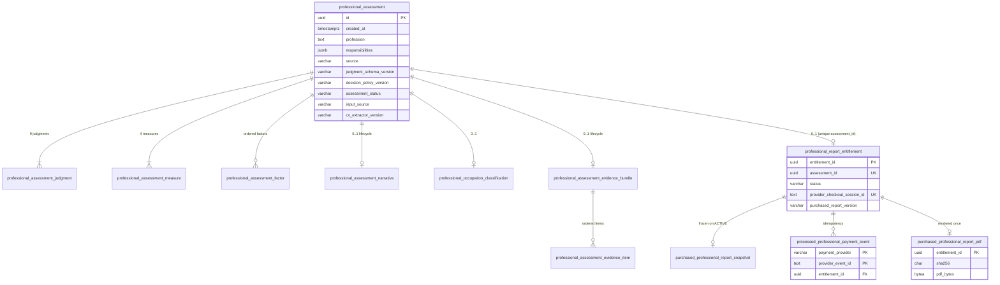
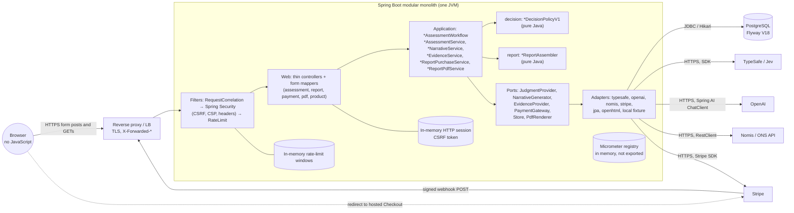
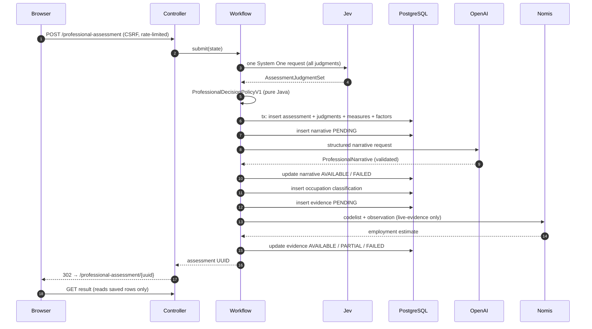

# AI Career Impact — system design

This document reviews the application as it stands on `main` (Flyway V18, Spring Boot 4.0.8, Java 21) and works through six questions:

1. [What traffic, storage and processing does it need?](#1-traffic-storage-and-processing-requirements)
2. [What are its endpoints, data structures and relationships?](#2-endpoints-data-structures-and-relationships)
3. [What are its components, and how do they communicate?](#3-components-and-how-they-communicate)
4. [Which components are likely to cause problems?](#4-components-likely-to-experience-problems)
5. [What are the risks, recovery mechanisms and trade-offs?](#5-risks-recovery-mechanisms-and-trade-offs)
6. [How will it scale as demand increases?](#6-how-the-system-scales-as-demand-increases)

It complements rather than repeats [ARCHITECTURE.md](ARCHITECTURE.md), which explains *why* each journey is shaped the way it is, and [PRODUCTION_READINESS.md](PRODUCTION_READINESS.md), which lists every limit and setting. Where this document states a number, it is either measured (and says where) or an explicit assumption that can be replaced with real data once traffic exists.

---

## System at a glance

AI Career Impact is a server-rendered modular monolith with three independent assessment journeys — **Professional**, **University** and **A-level** — sharing one deployment, one PostgreSQL database and one delivery pattern:

```text
form POST ─► Jev atomic judgments ─► Java decision policy ─► persist snapshot
                                                                │
          ┌─────────────────────────────────────────────────────┘
          ▼
   OpenAI narrative ─► (occupation classification) ─► evidence (Nomis/ONS) ─► persist
          │
          ▼
   redirect ─► GET free report (read-only, recomposed from saved rows)
          │
          ▼
   Stripe Checkout ─► signed webhook ─► ACTIVE entitlement + frozen paid snapshot
          │
          ▼
   GET paid report / GET PDF (rendered once, stored immutably)
```

Properties that drive almost every design conclusion below:

- **The write path is slow and expensive; the read path is cheap.** One submission makes up to four outbound network calls in series. Every subsequent page view is a primary-key lookup with no outbound call.
- **Saved records are immutable history.** Assessments, narratives, evidence, purchased snapshots and PDFs are never recalculated or regenerated.
- **No accounts.** The assessment UUID is the access token. There is no list endpoint.
- **No JavaScript.** The CSP forbids scripts (`script-src 'none'`), which constrains how asynchronous work can be shown to a user.
- **No infrastructure beyond PostgreSQL.** No cache, queue, object store or shared session store.

---

## 1. Traffic, storage and processing requirements

### 1.1 Assumptions

There is no production traffic yet, so the figures are modelled across three demand tiers. Replace the assumptions with real values once `assessments.created` and `payment.confirmations` are exported.

| Assumption | Value | Basis |
| --- | --- | --- |
| Demand tiers | 1,000 / 10,000 / 100,000 completed assessments per day | Launch / growth / national-scale |
| Peak-hour share of daily volume | 15% | Consumer web traffic concentrates in evenings |
| Event spike (e.g. A-level results day, a viral post) | 10× the normal peak hour, sustained for ~1 hour | Student journeys are strongly seasonal |
| Journey mix | 50% Professional, 25% University, 25% A-level | Professional is the default card |
| Paid conversion | 5% of assessments | Typical for a low-priced add-on |
| Purchases that download the PDF | 70% | |
| Page views per assessment session | 7 (home, form, submit, result ×2, methodology/privacy, paid report) | |

### 1.2 Measured latency of each outbound call

From [LIVE_AI_VERIFICATION.md](LIVE_AI_VERIFICATION.md) and [LIVE_EVIDENCE_VERIFICATION.md](LIVE_EVIDENCE_VERIFICATION.md):

| Call | Measured | Configured bound |
| --- | --- | --- |
| Jev judgments (TypeSafe SDK 0.2.0) | 1.2 s – 5.5 s | SDK defaults: 10 s read timeout, up to 2 retries, 30 s retry budget (checked only between attempts) |
| OpenAI narrative (`gpt-4o-mini`) | 6.1 s – 18.5 s (six live runs) | **Not set by the application**; Spring AI / client defaults apply and are unverified |
| Nomis evidence (two HTTP requests) | Not measured separately | 5 s connect, 10 s read, per request |
| Stripe Checkout Session creation | Not measured | Stripe SDK defaults |
| Java decision policy, persistence, rendering | Milliseconds | — |

Because the calls run in series inside the request, a **typical submission takes ~10–25 s** and a **bad-but-successful submission can take 60 s or more** (Jev retry plus a slow narrative plus slow Nomis).

### 1.3 Traffic

| | 1k/day | 10k/day | 100k/day | 100k/day spike (10×) |
| --- | ---: | ---: | ---: | ---: |
| Assessment submissions, average | 0.012/s | 0.12/s | 1.16/s | — |
| Assessment submissions, peak hour | 0.04/s | 0.42/s | 4.2/s | 42/s |
| Page views, peak hour | 0.3/s | 2.9/s | 29/s | 290/s |
| Checkout starts per day | 50 | 500 | 5,000 | — |
| Stripe webhooks per day (≈1 per purchase, plus retries) | ~50 | ~500 | ~5,000 | — |
| PDF downloads per day | 35 | 350 | 3,500 | — |

**Concurrent in-flight submissions** (Little's law: arrival rate × ~20 s mean duration):

| | 1k/day | 10k/day | 100k/day | 100k/day spike |
| --- | ---: | ---: | ---: | ---: |
| Requests held open on server threads | ~1 | ~8 | ~85 | **~850** |

Tomcat's default pool is 200 platform threads. The application is comfortable up to the 100k/day steady state, but **a results-day spike at that scale exhausts the request pool**, after which cheap page views queue behind slow submissions.

**Bandwidth** is not a constraint. Pages are ~20–40 KB of HTML, the single stylesheet is cached for five minutes and PDFs ~100 KB. Even at 100k/day this is ~25 GB/day egress, roughly 2–3 Mbit/s on average.

### 1.4 Outbound provider demand

Rough token sizing per call (prompt instructions plus the bounded user input, plus a structured response):

| Call | Input tokens | Output tokens |
| --- | ---: | ---: |
| Narrative | ~3,000 | ~800 |

| | 1k/day | 10k/day | 100k/day | 100k/day spike |
| --- | ---: | ---: | ---: | ---: |
| Jev requests per day | 1,000 | 10,000 | 100,000 | — |
| OpenAI requests per day (narrative) | 1,000 | 10,000 | 100,000 | — |
| OpenAI tokens per minute, peak hour | ~9.5k | ~95k | ~950k | **~9.5M** |
| Nomis requests per day (`live-evidence` only, 2 per professional assessment) | 1,000 | 10,000 | 100,000 | — |

The tokens-per-minute figure, not CPU, is the first hard ceiling: it has to fit within the OpenAI account's rate-limit tier, and the Jev equivalent has to fit TypeSafe's limits. Nomis is an anonymous public API, and fetching its full SOC codelist on every report becomes an etiquette and latency problem well before it becomes a cost one.

### 1.5 Unit economics

| Item | Per unit | Notes |
| --- | --- | --- |
| Report price | £4.99 Professional, £2.99 University, £1.99 A-level | `home.html` display text; the Stripe Price is authoritative |
| OpenAI narrative | ≈ $0.001 | At `gpt-4o-mini` list pricing; re-check current pricing |
| Jev judgment | **unknown** | The largest unknown in the cost model; obtain from TypeSafe |
| Stripe fee | ≈ 1.5% + 20p (UK cards) | About 11–12% of a £1.99 sale; re-check current pricing |

Every assessment incurs Jev and OpenAI cost; only ~5% earn revenue. The break-even condition is roughly:

```text
conversion × average net price  >  Jev cost + OpenAI cost + infrastructure cost per assessment
0.05 × ~£2.70                   ≈  £0.135 available per assessment
```

So **Jev must cost well under ~10p per call** for the free tier to be sustainable. Abuse matters for the same reason: every throttled-but-allowed submission is a paid upstream call, which is why rate limiting exists on exactly the write routes.

### 1.6 Storage

Estimated row sizes, from the Flyway schemas (typical / worst case, including index and tuple overhead):

| Record | Typical | Worst case | Notes |
| --- | ---: | ---: | --- |
| Assessment row + judgments (9–11) + measures (4–6) + factors (≤6) | ~8 KB | ~25 KB | Free text capped at 4,000 + 4,000 + 2,000 characters; JSONB lists and probability distributions |
| Narrative | ~4 KB | ~10 KB | One row per assessment |
| Evidence bundle + items | ~1 KB | ~5 KB | Often absent (no row = `NOT_REQUESTED`) |
| Occupation classification | ~0.3 KB | ~0.5 KB | Professional only |
| **Per assessment** | **~13 KB** | **~40 KB** | |
| Entitlement + processed payment event | ~1 KB | ~2 KB | Per checkout |
| Purchased snapshot (JSONB) | ~25 KB | ~60 KB | Per purchase |
| Purchased PDF (`BYTEA`) | ~100 KB | 5 MB (cap) | Per downloaded purchase; text-only, built-in fonts |

| | 1k/day | 10k/day | 100k/day |
| --- | ---: | ---: | ---: |
| Assessment data per year | ~4.7 GB | ~47 GB | ~470 GB |
| Purchase snapshots per year | ~0.5 GB | ~4.6 GB | ~46 GB |
| PDFs per year | ~1.3 GB | ~13 GB | ~128 GB |
| **Total per year** | **~6.5 GB** | **~65 GB** | **~650 GB** |

There is **no retention or deletion policy**, so storage grows without bound. At the top tier the PDFs are a fifth of the database while being the least-queried data in it. They are the clearest candidate for object storage, and `ProfessionalReportPdfStore` (and its siblings) already form the seam for that move.

In-memory state per instance:

- **HTTP sessions** hold only a CSRF token, 30-minute timeout in `prod`.
- **Rate-limiter windows** hold one entry per client per group, swept once more than 10,000 are tracked.

### 1.7 Processing

| Work | Cost | Where |
| --- | --- | --- |
| Request handling, validation, Thymeleaf rendering | Low CPU, milliseconds | Every request |
| Decision policies | Negligible: tens of multiply-adds | Per submission |
| Waiting on Jev / OpenAI / Nomis | No CPU, but **holds a request thread** for 10–60 s | Per submission |
| PDF rendering (OpenHTMLToPDF / PDFBox) | Hundreds of ms CPU, tens of MB heap | Once per purchase, first download only |
| Webhook processing | One short locking transaction plus report assembly and JSON encoding | Per purchase |

The application is **I/O-bound, not CPU-bound**. A 2 vCPU / 2–4 GB instance can render far more pages than the providers can serve judgments. Memory spikes come from concurrent first-time PDF renders, which is the place to size heap for.

---

## 2. Endpoints, data structures and relationships

### 2.1 Endpoints

All routes are server-rendered HTML unless stated. Every browser POST is CSRF-protected, and every result or report response is `private, no-store`.

**Product shell**

| Method | Path | Purpose | Notes |
| --- | --- | --- | --- |
| GET | `/` | Landing page and journey selector | |
| GET | `/methodology` | How assessments work | |
| GET | `/privacy` | Data handling | |
| GET | `/css/app.css` | The single stylesheet | `max-age=300, public` |
| — | `/error` | Shared error views (403, 404, 429, 5xx) | |
| GET | `/actuator/health[/liveness\|/readiness]`, `/actuator/info` | Probes | All other `/actuator/**` denied |

**Per journey** — `{journey}` is `professional-assessment`, `university-assessment` or `a-level-assessment`

| Method | Path | Purpose | Outbound calls | Rate-limit group |
| --- | --- | --- | --- | --- |
| GET | `/{journey}` | Form | — | — |
| POST | `/{journey}` | Validate, assess, enrich, redirect (PRG) | Jev, OpenAI, Nomis* | `assessment-submission` (10/min) |
| GET | `/{journey}/{uuid}` | Free result | — | — |
| POST | `/{journey}/{uuid}/checkout` | Create Stripe Checkout Session | Stripe | `checkout-start` (10/min) |
| GET | `/{journey}/{uuid}/report` | Frozen paid report, `ACTIVE` only (else 403) | — | — |
| GET | `/{journey}/{uuid}/report.pdf` | Immutable PDF, `ACTIVE` only (else 403) | — (renders once locally) | — |
| GET/POST | `/{journey}/{uuid}/checkout/local[/confirm]` | Simulated payment | — | `local-fixture` profile only |

\* Nomis only under `live-evidence`, and only for the Professional journey.

**Payment webhooks** (`live-payment` only; signature-authenticated, CSRF-exempt, never rate-limited)

| Method | Path | Accepts |
| --- | --- | --- |
| POST | `/payments/stripe/webhook` | Professional `checkout.session.completed` |
| POST | `/payments/stripe/university-webhook` | University, `product=university_report` |
| POST | `/payments/stripe/a-level-webhook` | A-level, `product=a_level_report` |

### 2.2 Core data structures

Domain and application types are immutable Java records with no JPA annotations; persistence entities live only in `*.persistence` packages.

| Structure | Kind | Contents |
| --- | --- | --- |
| `ProfessionalAssessmentState` / `UniversityAssessmentState` / `ALevelAssessmentState` | Domain input | The journey's validated, trimmed user input |
| `AssessmentJudgmentSet` → `DimensionJudgment` | Shared judgment model | Per dimension: numeric or categorical value, confidence, probability distribution |
| `ProfessionalMeasure` / `UniversityMeasure` / `ALevelMeasure` | Separate enums | 4 / 5 / 6 measures; deliberately not unified |
| `*DecisionResult`, `*MeasureResult`, `*DecisionFactor` | Policy output | Scores 0–10, bands, confidence, status, signed explanation factors |
| `AssessmentDecision`, `AssessmentStatus`, `AssessmentConfidence` | Shared result shape | `READY`, `READY_WITH_CAUTION`, `MORE_INFORMATION_REQUIRED`; `LOW`/`MODERATE`/`HIGH` |
| `*Narrative` | OpenAI structured output | HTML-free prose sections and 3–5 actions |
| `*EvidenceBundle` → `*EvidenceItem` | Evidence | Category, summary, source, publisher, safe URL, dates, optional metric triplet, quality |
| `*Report` | Composed view | Delivery-neutral `FREE` or `PAID` report |
| `*ReportEntitlement` | Payment state | `PENDING` → `ACTIVE` (also `FAILED`, `REFUNDED`, `REVOKED`) |
| `Purchased*ReportSnapshot` | Frozen JSONB | The exact paid report bought, versioned (`professional-report-v1`) |

Every saved record carries the versions that produced it: judgment schema (`professional-v1`), decision policy (`professional-decision-v1`), prompt (`professional-narrative-v1`), evidence (`professional-evidence-v1`), report (`professional-report-v1`), PDF layout (`professional-report-pdf-v1`), and, for historical CV-sourced assessments only, the CV parser and extractor.

### 2.3 Relationships

Each journey owns a parallel, fully separate set of tables; no foreign key crosses journeys. The professional set is shown; university (V8–V12) and A-level (V13–V17) mirror it without the classification table.



Relationship rules enforced in the schema:

- **Absence is a state.** No narrative, evidence or classification row means `NOT_REQUESTED`. Check constraints ensure only an `AVAILABLE` narrative carries content.
- **One entitlement per assessment** (`unique assessment_id`), one snapshot and one PDF per entitlement (primary keys), and an `ACTIVE` entitlement must carry a purchased version and confirmation time.
- **Idempotency** comes from the composite `(payment_provider, provider_event_id)` primary key.
- **PDF integrity** is checked in the database: `file_size = octet_length(pdf_bytes)` and the SHA-256 format.
- **All access is by primary key or unique key.** There are no range scans, search queries or listings, which makes the database workload trivially indexable.

---

## 3. Components and how they communicate

### 3.1 Component view



### 3.2 Communication styles

| From → To | Style | Notes |
| --- | --- | --- |
| Browser → app | Synchronous HTTP; HTML forms with Post/Redirect/Get | No client scripts; refresh repeats only the GET |
| Browser ↔ Stripe | Browser redirect to hosted Checkout and back | The return redirect is navigation, not proof of payment |
| Stripe → app | Asynchronous, at-least-once signed webhook | Stripe retries on non-2xx; idempotent on event ID |
| Controllers → application services | In-process method calls through use-case interfaces | Controllers hold no business rules |
| Application → providers | In-process port interfaces; adapters make **synchronous blocking HTTPS** calls | Exactly one adapter per port, chosen by Spring profile; no fallback |
| Application → PostgreSQL | JDBC through Hikari (10 connections), short transactions | Outbound calls happen **outside** transactions, so a slow provider never holds a connection |
| Modules → metrics | In-process Micrometer meters, never load-bearing | Not exported anywhere yet |

There is **no messaging, no background worker and no scheduler**. All enrichment (narrative, classification, evidence) runs synchronously on the submitting request's thread, after the assessment's own transaction has committed.

### 3.3 Submission sequence



Steps 3–5 are all-or-nothing: if Jev or the save fails, the user gets a 503 and nothing is stored. Steps 6 onward are best-effort: their failures are recorded as `FAILED` and never undo the assessment.

### 3.4 Payment sequence

1. `POST /{journey}/{uuid}/checkout` verifies that a complete PAID report can be composed, calls Stripe **outside** a transaction, then persists a `PENDING` entitlement in a short transaction and redirects to Stripe.
2. The user pays on Stripe-hosted Checkout and is redirected back to the free result, which still shows the purchase as pending.
3. Stripe delivers `checkout.session.completed`. The webhook controller verifies the signature, payment status and metadata, then in **one transaction** locks the entitlement row, assembles and freezes the paid report as JSONB, flips `PENDING → ACTIVE` and records the event ID.
4. The paid report and PDF become available. The first PDF request renders and stores the PDF with `ON CONFLICT DO NOTHING`; every later request streams the stored bytes.

---

## 4. Components likely to experience problems

Ranked by likelihood × impact.

### 4.1 The synchronous submission request — highest risk

One POST holds a request thread for the full Jev → OpenAI → Nomis chain: typically 10–25 s, and a minute or more in the tail.

- **Proxy and load-balancer idle timeouts.** Many default to 30–60 s. When the proxy gives up first, the server still finishes and commits the assessment, but the browser never receives the redirect. **The UUID is the only way back to a result and there is no listing, so that assessment, and the Jev and OpenAI spend behind it, is lost to the user.** This is the most likely real-world failure.
- **Double submission.** A user who waits 20 s with no feedback often clicks again or refreshes the POST. Each extra POST is a separate, fully paid Jev and OpenAI chain. The rate limiter permits 10 per minute, and nothing deduplicates them.
- **Thread exhaustion under spikes.** At ~850 concurrent submissions (section 1.3), Tomcat's 200 platform threads saturate, and cheap GETs for results and paid reports queue behind them.
- **Unbounded narrative duration.** The application sets no OpenAI timeout. A hung connection pins a thread for as long as the client default allows.

### 4.2 Jev as a hard dependency

There is deliberately no fallback (no fixture and no cached judgment). A TypeSafe outage, rate limit or credential problem means **no journey can complete an assessment**: a total outage of the product's core function. The SDK's retries also mean a single user action can bill up to three upstream attempts. The live verification notes this needs review against real billing behaviour.

### 4.3 Lifecycle rows stuck in `PENDING`

Narrative and evidence write `PENDING` before calling the provider. If the JVM dies, is redeployed or is OOM-killed during that call, the row stays `PENDING` permanently. `generateFor` and `gatherFor` return any existing row without retrying, and nothing sweeps stale rows, so the result page shows "temporarily unavailable" forever. Rolling deploys make this routine rather than rare.

### 4.4 Payment confirmation path

- A webhook that fails (database blip, report assembly error) rolls back correctly and Stripe retries. But **the customer has paid and sees no report** until a retry succeeds, and failed webhook processing is logged but not counted, so nobody is alerted.
- Only `checkout.session.completed` is consumed. **Refunds, disputes and chargebacks are not processed**, so a refunded purchase stays `ACTIVE`. The `REFUNDED` and `REVOKED` states exist but nothing sets them automatically.
- If the Stripe session is created but the `PENDING` write fails, an orphaned session exists. This is harmless (it expires and grants nothing), but if a customer manages to pay it, there is no entitlement to activate.

### 4.5 PostgreSQL as the single stateful component

Every journey, payment and PDF depends on one database. There is no stated backup, point-in-time recovery or high-availability configuration (that is deployment concern, but it is undecided), storage grows without a retention policy, and PDFs in `BYTEA` inflate backups and restore times.

### 4.6 Operational blindness

Metrics are recorded but not exported, so they are lost on restart and visible to nobody. The first sign of a Jev outage or a broken webhook secret is likely to be a customer email. Readiness deliberately excludes external providers (correctly), which also means nothing automated notices them failing.

### 4.7 Lower-risk items worth noting

- **Nomis** fetches the full SOC codelist for every new report. That is wasteful and makes evidence latency depend on a public API's mood. Its failure is soft.
- **PDF first render** is concurrent-safe by design (both renderers race, one wins), but under a burst of first downloads it is a CPU and heap spike.
- **The rate limiter** is per instance and keyed on client address. Users behind carrier-grade NAT, or a school network on results day, share one allowance. That is a real risk for the A-level journey: a classroom of 30 students on one public IP gets 10 submissions per minute between them.

---

## 5. Risks, recovery mechanisms and trade-offs

### 5.1 Risk register

| # | Risk | Likelihood | Impact | Existing recovery / mitigation | Recommended addition |
| --- | --- | --- | --- | --- | --- |
| R1 | Proxy timeout loses a completed assessment's UUID | High once deployed | Paid upstream spend wasted; user has no result | None | Set the proxy timeout ≥ 120 s now; move to async submission (6.2) |
| R2 | Duplicate POSTs double the upstream cost | High | Cost | Per-IP rate limit | Idempotency token in the form, stored with a unique constraint |
| R3 | Jev outage or quota | Medium | All new assessments fail | Clean 503, `judgment.failures`, no partial data stored | Alerting; explicit SDK timeouts and retries; a provider bulkhead; user-facing "try again later" copy |
| R4 | OpenAI outage or slowness | Medium | Narrative missing; slower submissions | Assessment still saved; `FAILED` narrative; free report still useful | Explicit timeout (~30 s); an explicit, audited "retry narrative" operation |
| R5 | Stuck `PENDING` rows after a crash or deploy | High with rolling deploys | Permanent "unavailable" sections | None | A sweeper marking `PENDING` older than N minutes as `FAILED`; graceful shutdown that drains in-flight requests |
| R6 | Webhook fails after the customer paid | Low–medium | Paid but no report; support load | Transaction rollback plus Stripe retries for days; idempotent re-delivery | Counter and alert on webhook failures; a manual re-drive runbook using the Stripe dashboard |
| R7 | Refund or chargeback leaves access `ACTIVE` | Medium | Revenue leakage; dispute risk | Status values exist | Consume `charge.refunded` and `charge.dispute.created` and set `REFUNDED`/`REVOKED` |
| R8 | Database loss or corruption | Low | Total loss, including purchased reports | Flyway validation; `clean` disabled | Managed PostgreSQL with PITR; tested restores; PDFs out of the database at scale |
| R9 | Heap exhaustion from PDF bursts | Low–medium | Instance restart; triggers R5 | Per-document limits | A semaphore bounding concurrent renders; heap sized for it |
| R10 | UUID leakage exposes someone's assessment or paid report | Medium | Privacy (personal data in free-text answers) | 122-bit random UUIDs, `noindex`, `no-store`, no listing, identical 404s | Accounts or emailed magic links; a retention and deletion policy |
| R11 | Unbounded data retention | Certain | GDPR exposure; cost | None | A documented retention period with a deletion job (purchases may need longer for accounting) |
| R12 | Cost runaway from abuse | Medium | Direct spend | Per-IP limits; CSRF; bounded inputs | A global daily spend circuit breaker; per-provider concurrency caps |
| R13 | Model wording drift contradicting saved bands | Medium | Trust | Prompt contracts; validators; scores never from the model | Expand the validator with band-consistency checks; sample review |
| R14 | Shared-IP throttling of legitimate students | Medium on results day | Lost users | Configurable permits | Raise the submission limit or key on session plus IP once behind a trusted proxy |

### 5.2 Recovery mechanisms already designed in

The codebase is careful about failure. These properties already hold and should be preserved through any scaling change:

- **Persistence-first, enrichment-second.** The authoritative assessment commits before anything optional runs, so narrative, classification and evidence failures degrade the report rather than fail it.
- **No transaction spans a network call.** Jev, OpenAI and Stripe calls happen outside transactions. A slow provider cannot exhaust the connection pool, and a rollback never needs to "undo" an external call.
- **Idempotent payment confirmation.** Event-ID primary key, row lock, recheck, then an atomic snapshot-plus-activation in one transaction. An `ACTIVE` entitlement without its snapshot cannot exist, so redelivery is always safe.
- **Concurrency-safe immutable PDFs.** `ON CONFLICT DO NOTHING` plus reading back the winner: no lock, no queue, identical bytes forever.
- **Read path independent of providers.** GETs never call Jev, OpenAI, evidence or Stripe. A provider outage cannot affect anyone viewing an existing result or a purchased report.
- **Profiles, not exceptions, select adapters.** There is no silent live-to-fixture fallback, and the startup validator refuses contradictory profiles and missing secrets.
- **Health that does not cascade.** Liveness ignores external providers, so their outages never trigger restart loops.
- **Versioned history.** Every record names the schema, policy, prompt and report version that produced it, so a future change cannot reinterpret past results.

### 5.3 Key trade-offs

| Decision | Benefit | Cost | Verdict |
| --- | --- | --- | --- |
| **Modular monolith** rather than services | One deploy, one database, in-process calls, simple transactions, cheap to run | Everything scales together; one bad parse can affect every journey | Right for current and medium-term demand: the bottleneck is upstream providers, not compute |
| **Synchronous enrichment** in the POST | No queue or worker; the result is complete on first view; simple to test | Long request times, proxy timeouts, thread pressure (R1, R2) | Acceptable at launch with a long proxy timeout; the first thing to change as volume grows |
| **No provider fallback** | A score is never silently from a fixture; honest provenance | Jev is a single point of failure for new assessments | Correct for product integrity; mitigate with alerting and clear UX rather than fallback |
| **Store immutable snapshots and PDFs** | Reproducible, auditable purchases; no re-render cost | Storage growth; data duplication between snapshot and source rows | Correct; revisit storage location (object store) rather than the principle |
| **PDFs in PostgreSQL `BYTEA`** | One store; transactional consistency; no new infrastructure | Backup size; database storage cost at scale | Fine below ~10k/day; move behind the existing `PdfStore` port later |
| **In-memory rate limiter** | No Redis | Per-instance allowance; shared-IP false positives | Fine for 1–3 instances; a shared limit can use PostgreSQL before anything else is added |
| **In-memory sessions** | No session store | Lost on restart; sticky sessions needed for more than one instance | Use Spring Session JDBC on the existing database |
| **UUID-as-capability, no accounts** | Zero signup friction | Leaked URL means leaked report; lost URL means lost report | Acceptable pre-launch; the main product-level gap before scale |
| **No JavaScript** | Tiny attack surface; strict CSP; accessible | Progress feedback for slow work must use `<meta http-equiv="refresh">` | Workable; see 6.2 |
| **Per-journey duplication** (tables, payments, PDFs) | Journeys release independently; semantics stay legible | More code; changes repeated three times | Deliberate and documented; keep it |

---

## 6. How the system scales as demand increases

### 6.1 What breaks first

As demand rises, constraints are hit in this order. Compute is last.

1. **Upstream quotas and cost**: Jev and OpenAI rate limits (section 1.4), and the free-tier cost per assessment.
2. **Request duration**: proxy timeouts and double-submits (R1, R2) appear at any volume. Thread exhaustion appears at spike volumes.
3. **Memory**: concurrent first-time PDF renders.
4. **Single-instance availability**: deploys and crashes cause downtime and stuck `PENDING` rows.
5. **Database storage**: driven mostly by PDFs and the lack of retention.
6. **Database throughput**: effectively never at these volumes. Every query is a primary-key lookup, and each submission writes about 20–30 small rows.

### 6.2 Scaling stages

Each stage adds only what the previous one can no longer handle, in keeping with the project rule against premature infrastructure.

#### Stage 0 — launch (up to ~2k assessments/day)

One instance (2 vCPU, 2–4 GB heap) behind a TLS proxy, with managed PostgreSQL.

- Set the **proxy/LB request timeout to at least 120 s** (mitigates R1).
- Set **explicit timeouts** on the Jev SDK and the OpenAI client (for example 15 s and 30 s), and decide deliberately whether Jev retries are wanted given billing.
- Add a **stale-`PENDING` sweeper** (R5) and enable graceful shutdown (`server.shutdown=graceful`) with a drain period longer than the slowest submission.
- Add a **submission idempotency token** (R2): a hidden form field with a unique constraint, so a second POST redirects to the first result.
- **Export metrics** (one Micrometer registry) and alert on `judgment.failures`, checkout failures and webhook failures.
- Enable **managed backups with point-in-time recovery**, and test one restore.

#### Stage 1 — growth (~2k–30k/day)

Two or three instances for availability and zero-downtime deploys.

- **Asynchronous submission without a broker.** The POST validates, inserts a `submission` row (`RECEIVED`) and immediately redirects to `/{journey}/{uuid}`. That page renders a "preparing your assessment" view with `<meta http-equiv="refresh" content="3">`, which works with the existing no-JavaScript CSP. An in-process worker pool claims work with `SELECT … FOR UPDATE SKIP LOCKED` on PostgreSQL and runs the existing workflow unchanged. This removes R1 (the UUID reaches the user in milliseconds), bounds upstream concurrency to the pool size, and makes crash recovery a matter of re-claiming unfinished rows. No new infrastructure is needed. The trade-off is a status page, and an accepted assessment that later fails needs a terminal "could not be completed" state.
- **Virtual threads** (`spring.threads.virtual.enabled=true`, Java 21). Whatever stays blocking (checkout creation) no longer consumes scarce platform threads. Check the PostgreSQL driver version for pinning-free locking.
- **Bulkheads.** Use semaphores on Jev, OpenAI and PDF rendering concurrency, so a provider slowdown or a render burst cannot consume the whole instance.
- **Shared sessions.** Enable Spring Session JDBC on the existing database, or use sticky sessions as an interim measure.
- **Rate limiting.** Accept the per-instance multiplier (it is documented), and, now that a trusted proxy exists under `prod`, revisit keying so school networks are not starved (R14).
- **Webhook completeness.** Handle refunds and disputes (R7), and add a webhook failure counter.
- **Cache the Nomis SOC codelist** in memory with a daily refresh. It changes rarely and is identical for every request.
- **Retention policy.** Agree and implement it (R11) before data volume makes it a migration project.

#### Stage 2 — scale (~30k–300k/day, seasonal spikes)

Horizontal app instances (stateless after Stage 1) autoscaled on worker-queue depth rather than CPU.

- **PDFs to object storage** behind the existing `*ReportPdfStore` ports. The database keeps metadata and the hash, and the bytes move to S3-compatible storage. This shrinks the database and backups by roughly a fifth to a third.
- **Provider capacity becomes a commercial task**: raise OpenAI tier limits, negotiate Jev throughput, and consider a global spend circuit breaker (R12). The worker queue absorbs results-day spikes: assessments wait in `RECEIVED` rather than failing, at the cost of longer waits.
- **Shared rate limiting**, if per-instance multiplication becomes too loose. Implement it in PostgreSQL first (a counter table keyed on window); bring in Redis only if that measurably hurts.
- **Database**: a larger instance plus PgBouncer if instance count × pool size approaches the connection limit. Consider time-partitioning the assessment tables only if retention deletes become expensive. Read replicas are not needed: reads are primary-key lookups on small rows.
- **Static assets**: put the stylesheet behind a CDN with content hashing, then lengthen its cache lifetime.
- **Accounts or magic-link email** (R10). This is not a scaling requirement as such, but at this volume lost and leaked UUIDs become a support and privacy problem.

#### Stage 3 — beyond (~300k+/day)

The likely next pressure is organisational (team size, release cadence per journey), not technical. Because each journey is already a vertical slice with its own tables, payments and webhooks, a journey could be extracted into its own deployable along existing package boundaries **if and when** independent release or scaling is genuinely needed. Until then the monolith remains the right shape.

### 6.3 Capacity summary

| | Stage 0 | Stage 1 | Stage 2 |
| --- | --- | --- | --- |
| Assessments per day | ≤ 2k | 2k–30k | 30k–300k |
| App instances | 1 | 2–3 | Autoscaled, ~3–10 |
| Submission model | Synchronous, long proxy timeout | Async via PostgreSQL work table + meta refresh | Same, queue-depth autoscaling |
| Sessions | In memory | Spring Session JDBC (or sticky) | Spring Session JDBC |
| Rate limiting | In memory per instance | Per instance, proxy-aware keying | PostgreSQL-shared if needed |
| PDF storage | PostgreSQL `BYTEA` | PostgreSQL `BYTEA` | Object storage behind existing port |
| Database | Managed single primary + PITR | Same, larger | Larger + PgBouncer; optional partitioning |
| New infrastructure | None | None | Object storage; maybe CDN |
| Dominant constraint | Request duration | Provider concurrency and cost | Provider quotas and spend |

---

## Appendix — open questions to resolve with real data

1. What does a Jev System One request cost, and does each SDK retry bill separately?
2. What are the actual OpenAI and TypeSafe rate-limit tiers on the production accounts?
3. What timeout does the production proxy or load balancer apply?
4. What is the real paid conversion rate and journey mix? (Export `assessments.created` and `payment.confirmations`.)
5. What retention period is acceptable for assessment content, and separately for purchase records?
6. How large are real PDFs? (Replace the estimates in sections 1.6–1.7.)
